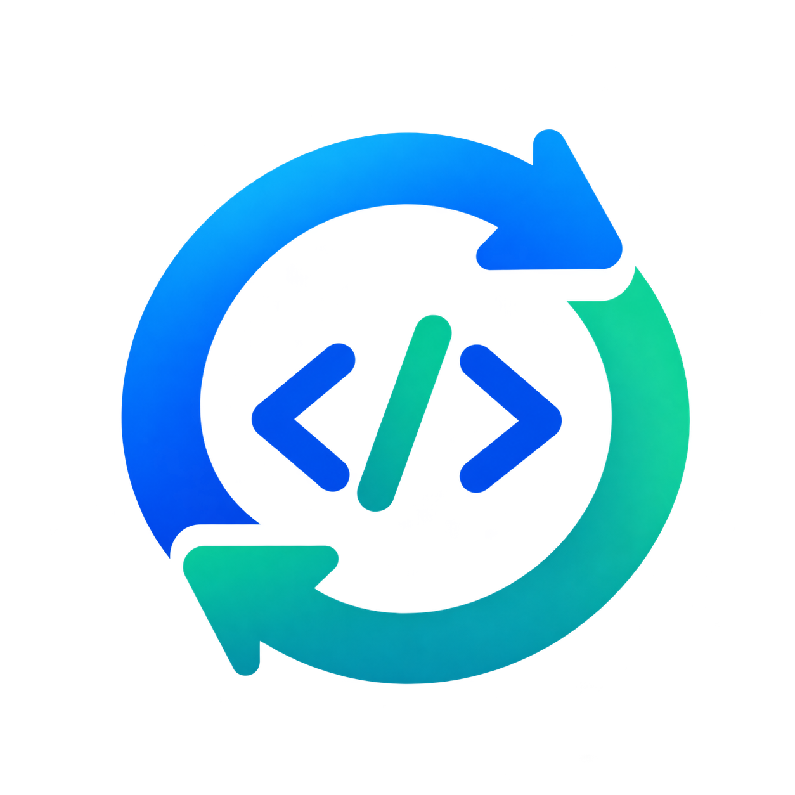

<p align="center">
  
</p>

<h1 align="center">cass-improve-system</h1>

<p align="center">
  <strong>Turn a week of scattered coding-agent sessions into concrete improvements.</strong>
</p>

<p align="center">
  <a href="https://github.com/LucioB16/cass-improve-system/actions/workflows/ci.yml"></a>
  <a href="LICENSE"></a>
  <a href="https://github.com/LucioB16/cass-improve-system/issues"></a>
</p>

## Overview

Coding agents accumulate useful context across many sessions and
repositories: the same mistakes, corrections, debugging loops, and manual
procedures repeat, but those patterns are nearly impossible to see when
each session is considered on its own.

cass-improve-system performs a **batch retrospective** across your
historical coding-agent sessions. It works **across sessions, projects,
and CASS-visible agent histories** — with no per-session hooks and no need
to invoke anything inside the original work sessions — and recommends
actionable improvements backed by traceable evidence.

## Quick Start

### Requirements

- A coding agent with Agent Skills support (OpenCode, Claude Code, Cline,
  Freebuff CLI).
- Python 3.
- [CASS](https://github.com/Dicklesworthstone/coding_agent_session_search)
  installed separately (external dependency, not bundled).
- Windows, Linux, or macOS.

Details: [docs/installation.md](docs/installation.md).

### Install with your coding agent (recommended)

You do not need to clone anything manually — copy the prompt below into a
fresh session of your coding agent and let it perform the installation:

```text
Install the cass-improve-system skill from:
https://github.com/LucioB16/cass-improve-system

1. Detect the operating system and available shell first.
2. Inspect that repository and its installation documentation.
3. Clone or download the repository into a suitable temporary or workspace
   directory before running any relative installation script.
4. Check whether CASS is already installed (`cass --version`).
5. If CASS is missing, install it with the official upstream-supported
   installer documented in docs/installation.md (never invent flags).
6. Verify the installed CASS version meets the documented minimum.
7. Check whether a usable CASS index already exists
   (`cass health --json`, `cass status --json`).
8. Distinguish an uninitialized first-time index from an already healthy one.
9. If this is a first-time setup, explain that one initial full index
   (`cass index --full`) is required and request confirmation before
   running it. Do NOT rebuild an existing healthy index.
10. Install the skill with the platform-appropriate repository installer
    into the canonical global location
    ~/.agents/skills/cass-improve-system/.
11. Preserve the supported Claude Code and Cline compatibility paths and
    respect any existing compatible parent-level directory aliases.
12. Run the repository's documented installation verification.
13. Report the installed paths, CASS version, detected integrations, and
    the final verification result.
14. Stop and explain clearly if any dependency cannot be installed or any
    verification step fails.
```

### Manual installation

Prefer manual control? Follow the step-by-step guide (CASS setup, first
index, skill install, verification, troubleshooting):

[Manual installation and troubleshooting](docs/installation.md)

## Usage

Open a **fresh** coding-agent session and ask for a retrospective. Nothing
needs to run inside the original work sessions. By default every
CASS-visible agent and workspace is in scope; you choose the period:

```text
Use cass-improve-system to review all my coding-agent sessions from the
last 24 hours.
```

```text
Analyze all my coding-agent sessions from the last 7 days and suggest
improvements. Do not apply changes.
```

```text
Use cass-improve-system to review all my coding-agent sessions from the
last 30 days across every project. Identify recurring mistakes, useful
corrections, automation opportunities, and potential new or improved
Agent Skills. Do not apply changes.
```

```text
Review sessions from 2026-10-01 through 2026-10-06 and find things I keep
repeating that should become skills or automations.
```

Executing agents (OpenCode, Claude Code, Cline, Freebuff CLI) run the
Skill; CASS-ingested histories (Codex, Claude, OpenCode, Antigravity, …)
supply the evidence. One does not imply the other. Optional
agent/workspace filters exist — see [docs/architecture.md](docs/architecture.md).

## What You Get

A decision document, not a transcript dump. Illustrative example — not
from real user data:

```text
### Repeated manual deployment steps [manual_procedure:a1b2c3d4]
Type: manual_procedure
Destinations: AUTOMATION, NEW SKILL
Evidence: 4 occurrences across 3 sessions, 2 projects
Representative evidence:
- session A: "cada vez tengo que copiar el .env a mano, es tedioso"
- session B: "I manually copy the config file every time I deploy"
Why it matters: the same friction recurs across projects.
Proposed improvement: a deploy script or Skill (draft on approval).
Confidence: medium — approval required before applying.
```

Reports also cover repeated mistakes, debugging loops, duplicated
research, existing-skill improvements, global/project rule candidates,
tooling gaps, and successful patterns worth preserving — each with
traceable evidence, or an explicit statement when nothing strong was found.

## Features

- Cross-session, cross-project retrospectives over all CASS-visible history.
- Flexible periods (24h, N days, date ranges) with agent/workspace filters.
- Repeated-mistake, correction, and debugging-loop detection, including
  Spanish-language sessions.
- Automation, Skill, and instruction improvement opportunities.
- Evidence-backed, provenance-aware recommendations with conservative
  confidence scoring.
- Safe report-only behavior: full-session scanning, bounded context, no
  automatic changes.
- Windows, Linux, and macOS installation; OpenCode, Claude Code, Cline,
  and Freebuff CLI integration.

## Compatibility

| Agent | Integration | Evidence |
|---|---|---|
| OpenCode | canonical `.agents` installation | production 24h, 7d, and 30-day reviews |
| Claude Code | compatibility path to canonical | install-path verification |
| Cline | native Agent Skills, compatibility path to canonical | E2E on Cline 3.0.68 |
| Freebuff CLI | native global Skill discovery from canonical `.agents` | independent 30-day acceptance (207 sessions, 142 WAL recoveries, 0 skipped) |
| GitHub Copilot App | native Skill discovery from canonical `.agents` | independent E2E ran the full pipeline |
| Copilot CLI history | CASS `copilot_cli` sessions as review corpus | decoding implemented and verified on real export shape; live-history E2E pending independent retest |

Copilot App/CLI session history (`copilot_cli` in CASS) is supported as
review input: Chronicle `events.jsonl` exports are normalized to
user/assistant/tool roles with content-coverage reporting. Standalone
Copilot CLI invocation was not separately tested (validation ran inside
Copilot App); VS Code Copilot Chat history is a separate source and is
not claimed.

Freebuff CLI support means the Freebuff command-line harness; Freebuff
Desktop global-home-Skill behavior is not claimed. Windows, Linux, and
macOS installers are CI-tested; live history validation was performed on
Windows.

## How It Works

```text
Historical coding-agent sessions
              |
              v
       CASS discovery
              |
              v
  Inventory and normalization
              |
              v
   Cross-session aggregation
              |
              v
 Evidence-backed recommendations
```

In implemented terms: **Preflight** verifies CASS (with one bounded
incremental refresh only on stale-only state) → **Inventory** enumerates
sessions with explicit COMPLETE/CAPPED coverage → **Normalize** exports
and scans full sessions with provenance, period, and redaction handling →
**Aggregate** clusters signals with provenance- and period-aware
confidence → **Report** renders stable, deduplicated findings for final
human/agent judgment. Details: [docs/architecture.md](docs/architecture.md).

## Safety & Privacy

- No automatic changes to project repositories or source code.
- No automatic promotion into global instructions.
- No automatic creation or modification of Agent Skills.
- Human approval is required before applying any recommendation.
- Session content is treated as untrusted data; credentials are redacted
  by the Skill's mechanisms.
- One deliberate exception to read-only operation: if preflight finds a
  merely stale CASS index, it may run one bounded incremental `cass index`
  refresh (never `--full`), updating only CASS-derived index state — never
  original conversation data or source repositories.
- CASS ingestion is local; if your coding agent uses remote LLM inference,
  that agent's own provider policy applies to whatever it sends there.

## Documentation

- [docs/installation.md](docs/installation.md) — requirements, CASS setup,
  first index, skill install/verify/update/uninstall, troubleshooting.
- [docs/architecture.md](docs/architecture.md) — pipeline design,
  normalization, provenance, period semantics, confidence, retention.
- [docs/cass-integration.md](docs/cass-integration.md) — CASS interface,
  indexing, inventory, export behavior, WAL recovery, upstream limitations.
- [docs/testing.md](docs/testing.md) — test suites, cross-platform
  validation, historical acceptance evidence.

## Development & Validation

```powershell
python -m unittest discover -s tests -v
```

Stdlib-only Python, no third-party dependencies. CI runs the suite plus an
isolated-HOME install/verify/reinstall/uninstall exercise on Windows,
Ubuntu, and macOS. Historical validation snapshot (v1.5.0): 147
deterministic tests, 6/6 CI checks, and an independent Freebuff CLI
30-day acceptance (207 sessions, 3 harnesses, 24 workspaces, 142 WAL
recoveries, 0 skipped, COMPLETE inventory) — see
[docs/testing.md](docs/testing.md) for details and past acceptance records.

## License

MIT — see [LICENSE](LICENSE). CASS is a separate project with its own
license/terms; this project is not affiliated with or endorsed by CASS upstream.
